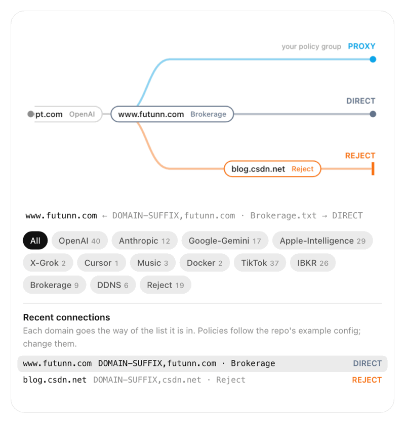
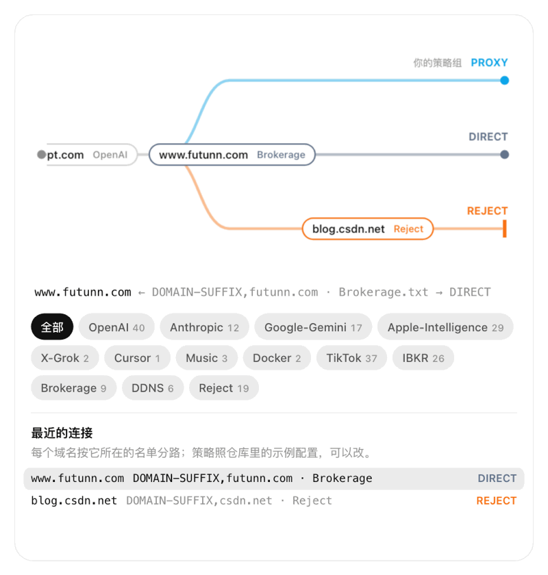

<div align="center">
  
  <h1>funnysurge</h1>
  <p>
    
    
    
    <a href="LICENSE"></a>
  </p>
  <p><a href="#english">English</a> · <a href="#简体中文">简体中文</a></p>
  <p><a href="docs/rules.md">Rule catalog · 规则索引</a> · <a href="docs/usage.md">Setup guide · 配置指南</a></p>
</div>

## English

funnysurge is a set of hand-maintained routing rule sets for Surge and Clash / Mihomo.
The lists cover AI services, development tools, media, direct connections, and
sites I choose to block. Subscribe to the lists you need and assign your own policies.

<p align="center">
  <a href="https://max1874.com/funnysurge/"></a>
  <br>
  <sub>A recorded demo from <a href="https://max1874.com/funnysurge/">max1874.com/funnysurge</a>, where you can try it yourself.</sub>
</p>

### Pick what you need

| I want to… | Start here |
| --- | --- |
| Route ChatGPT, Claude, Gemini, or another service | [Rule catalog](docs/rules.md), with raw links for each client |
| Add rules to an existing Surge profile | [Surge quick start](#surge) |
| Add rule providers to Clash / Mihomo | [Clash / Mihomo quick start](#clash--mihomo) |
| Understand the personal blocklist | [Reject policy and sources](docs/rules.md#reject-policy-and-sources--reject-策略与来源) |

### Quick start

Start with a working client configuration and a proxy or policy group of your
own. The examples below use `PROXY`; replace it with your existing policy name.

#### Surge

Add this line inside your existing `[Rule]` section, before broader matching
rules and `FINAL`:

```ini
RULE-SET,https://raw.githubusercontent.com/max1874/funnysurge/main/rules/OpenAI.txt,PROXY
```

Save the profile, refresh the rule set, and inspect a matching request in Surge
to see which rule and policy it actually used. Find more lists, including direct
and reject rules, in the [rule catalog](docs/rules.md).

#### Clash / Mihomo

Merge this provider into `rule-providers` and its rule into `rules`. Place the
rule before broader matches and `MATCH`; keep your existing proxies and groups.

```yaml
rule-providers:
  funnysurge-openai:
    type: http
    behavior: classical
    format: yaml
    url: https://raw.githubusercontent.com/max1874/funnysurge/main/clash/OpenAI.txt
    path: ./rule-providers/funnysurge-openai.yaml
    interval: 86400

rules:
  - RULE-SET,funnysurge-openai,PROXY
```

These `.txt` files contain YAML `payload` lists. Use `behavior: classical` and
`format: yaml`. See the [setup guide](docs/usage.md#english) for merging, updates, and
troubleshooting.

### What's inside

```text
funnysurge/
├── README.md                  Bilingual overview
├── rules/                     Surge rule sets (.txt)
├── clash/                     Clash / Mihomo classical providers (.txt, YAML)
├── docs/                      Rule catalog, setup guides, and coverage notes
├── assets/                    Project icon and README demos
└── LICENSE                    MIT
```

`rules/` and `clash/` keep their published paths so existing raw
subscriptions continue to work. Browse by service through the catalog, or by
client through the two rule directories.

### FAQ

#### Does this include proxy servers or a subscription?

No. A rule selects the policy for a connection. Supply the proxies in your
client configuration.

#### Should I use `AI.txt` or the individual service lists?

Use `AI.txt` when every AI service should take the same policy. Use the
individual lists when services need different policies, and put them before
`AI.txt` if you use both.

#### Does it work with Clash Verge Rev?

Clash Verge Rev runs the Mihomo core, so use the `clash/` files as
`behavior: classical`, `format: yaml` rule providers, as in the
[Clash / Mihomo quick start](#clash--mihomo).

#### How are the lists updated?

By hand, with no generator, CI, or scheduled sync. Raw links follow `main`;
refresh the rule set or provider in your client to pick up changes.

#### How does this relate to Sukka, blackmatrix7, or Loyalsoldier rules?

Those cover far more ground. These lists are small and specific, and you can
combine them with those projects' rules in your client.

More on the project page: <https://max1874.com/funnysurge/>

### Scope and maintenance

- **Personal, manually curated coverage.** Lists reflect my setup and may need
  adjustment for yours. Some entries match shared infrastructure or broad
  keywords; service labels do not mean every match belongs only to that service.
- **Choose an aggregate or individual lists.** `AI.txt` combines several
  services and some additional domains. It is maintained separately, rather
  than generated as an exact union of the individual files.
- **The client formats have differences.** There are 21 Surge lists and 20
  Clash lists; TikTok is currently Surge-only. Same-name lists can differ in
  coverage. The [catalog](docs/rules.md) records the known differences.
- **Reject expresses a preference.** It includes sites such as CSDN and
  cnblogs. It blocks connections, not search results, and is not a malware
  classification. Read the [policy and sources](docs/rules.md#reject-policy-and-sources--reject-策略与来源) before enabling it.

For a correction, include the affected domain, client, rule file, and expected
route in an [issue](https://github.com/max1874/funnysurge/issues). See the
[maintenance notes](docs/usage.md#maintaining-rules) before editing a list.

### License

This repository is licensed under [MIT](LICENSE) © 2024 MAX LIN. Original copyright notices
are preserved.

## 简体中文

funnysurge 是一组手工维护的 Surge 与 Clash / Mihomo 分流规则集。规则覆盖 AI 服务、开发工具、媒体、直连需求和个人屏蔽名单。按需订阅规则，再指定适合自己的策略。

<p align="center">
  <a href="https://max1874.com/funnysurge/"></a>
  <br>
  <sub>动图录自 <a href="https://max1874.com/funnysurge/">max1874.com/funnysurge</a>，那里可以亲手试。</sub>
</p>

### 从哪里开始

| 你想做什么 | 对应入口 |
| --- | --- |
| 为 ChatGPT、Claude、Gemini 等服务单独分流 | [规则索引](docs/rules.md)，包含各客户端的原始订阅链接 |
| 给已有 Surge 配置添加规则 | [Surge 快速开始](#surge-配置) |
| 给 Clash / Mihomo 添加 rule-provider | [Clash / Mihomo 快速开始](#clash--mihomo-配置) |
| 了解个人屏蔽名单的取舍 | [Reject 策略与来源](docs/rules.md#reject-policy-and-sources--reject-策略与来源) |

### 快速开始

先准备一份能正常使用的客户端配置，以及自己的代理节点或策略组。以下示例用 `PROXY` 作为策略名，请替换成你已有的策略名称。

#### Surge 配置

把这一行放进已有的 `[Rule]` 段，排在可能先匹配的宽泛规则和 `FINAL` 之前：

```ini
RULE-SET,https://raw.githubusercontent.com/max1874/funnysurge/main/rules/OpenAI.txt,PROXY
```

保存配置并更新规则集后，在 Surge 请求记录中查看实际命中的规则和策略。其他服务以及可选的直连和屏蔽规则见[规则索引](docs/rules.md)。

#### Clash / Mihomo 配置

把 provider 合并到已有的 `rule-providers`，把匹配规则合并到 `rules`，排在可能先匹配的宽泛规则和 `MATCH` 之前。保留自己的节点和策略组。

```yaml
rule-providers:
  funnysurge-openai:
    type: http
    behavior: classical
    format: yaml
    url: https://raw.githubusercontent.com/max1874/funnysurge/main/clash/OpenAI.txt
    path: ./rule-providers/funnysurge-openai.yaml
    interval: 86400

rules:
  - RULE-SET,funnysurge-openai,PROXY
```

这些 `.txt` 文件实际包含 YAML `payload` 列表，应使用 `behavior: classical` 和 `format: yaml`。合并方式、更新与排查说明见[配置指南](docs/usage.md#简体中文)。

### 目录结构

```text
funnysurge/
├── README.md                  中英双语总览
├── rules/                     Surge 规则集（.txt）
├── clash/                     Clash / Mihomo 规则集（.txt，内容为 YAML）
├── docs/                      规则索引、配置指南和覆盖说明
├── assets/                    项目图标和 README 演示动图
└── LICENSE                    MIT 许可证
```

`rules/` 和 `clash/` 保留原有公开路径，已有的规则集订阅链接可以继续使用。按服务找规则看索引，按客户端找文件看对应目录。

### 常见问题

#### 这里提供节点或订阅吗？

不提供。规则只决定连接匹配到哪个策略，策略背后的节点需要自备。

#### 用 `AI.txt` 还是单个服务的名单？

所有 AI 服务走同一个策略时用 `AI.txt`；不同服务要走不同策略时用独立名单。两者都用的话，把独立名单排在 `AI.txt` 前面。

#### Clash Verge Rev 能用吗？

Clash Verge Rev 内置 Mihomo 内核，按 `behavior: classical`、`format: yaml` 引用 `clash/` 下的文件即可，参考 [Clash / Mihomo 快速开始](#clash--mihomo-配置)。

#### 名单怎么更新？

手工修改，没有生成脚本、CI 或定时同步。原始链接跟随 `main`，在客户端刷新规则集或 provider 即可拿到新内容。

#### 和 Sukka、blackmatrix7、Loyalsoldier 的规则是什么关系？

那些项目覆盖范围大得多。这里的名单小而具体，可以在同一份客户端配置中搭配使用。

项目页面：<https://max1874.com/funnysurge/>

### 范围与维护方式

- **个人筛选，手动维护。** 规则反映我的使用习惯，可能需要按你的环境调整。部分条目匹配共享基础设施或较宽的关键词，服务名称不代表命中的连接只属于该服务。
- **聚合规则与独立规则按需选择。** `AI.txt` 包含多个 AI 服务和一些额外域名，独立维护，并非其他文件自动合并后的精确合集。
- **两种格式存在差异。** 当前有 21 份 Surge 规则、20 份 Clash 规则；TikTok 暂时只有 Surge 版。同名文件的覆盖范围也可能不同，已知差异见[规则索引](docs/rules.md)。
- **Reject 是个人访问偏好。** 名单包含 CSDN、博客园等站点，阻止连接，不会隐藏搜索结果，也不代表恶意网站判定。启用前请阅读[策略与来源](docs/rules.md#reject-policy-and-sources--reject-策略与来源)。

如需纠错，请在 [issue](https://github.com/max1874/funnysurge/issues) 中提供受影响的域名、客户端、规则文件和期望的分流结果。修改规则前可先看[维护约定](docs/usage.md#维护规则)。

### 许可证

本仓库采用 [MIT](LICENSE) 许可证，© 2024 MAX LIN，保留原有版权声明。
