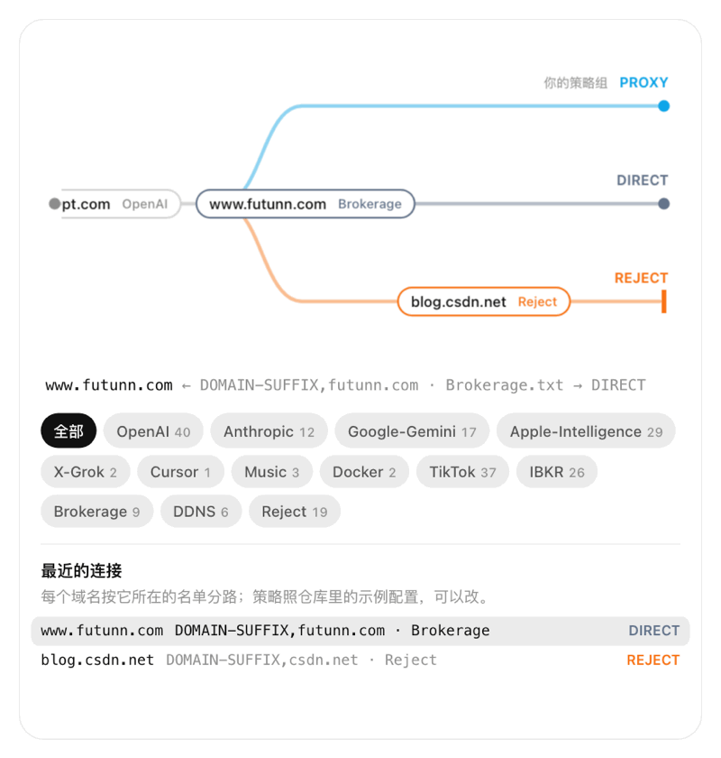

  
  <h1>funnysurge</h1>
  
<a href="docs/rules.zh-Hans.md">规则索引</a> · <a href="docs/usage.zh-Hans.md">配置指南</a> · <a href="README.md">English</a>

手工维护的 Surge 和 Clash / Mihomo 分流规则集，覆盖 AI 服务、开发工具、媒体和个人屏蔽名单。选好规则后，在自己的客户端配置里指定策略。代理节点需自备。

## 开始使用

1. 找到所需的规则集，复制对应客户端的订阅链接。[规则索引](docs/rules.zh-Hans.md)
2. 把规则添加到现有配置。指南里有可复制的示例，也说明如何查看实际命中的策略。[Surge](docs/usage.zh-Hans.md#surge) · [Clash / Mihomo](docs/usage.zh-Hans.md#clash--mihomo)

多个 AI 服务共用一个策略时，选 `AI.txt`。想给 ChatGPT、Claude 或 Gemini 分别指定策略时，选单独的规则集。两种都用时，把单独的规则集排在前面。[覆盖说明](docs/rules.zh-Hans.md#覆盖说明)

  
   
  <a href="https://max1874.com/funnysurge/">试试分流演示</a>

订阅链接跟随 `main`。在客户端更新规则集即可拉取新内容。如果发现域名漏匹配或走错策略，反馈时请附上客户端、域名、实际命中的规则和预期策略。[提交问题](https://github.com/max1874/funnysurge/issues)

[MIT](LICENSE) © 2024 MAX LIN，保留原有版权声明。
